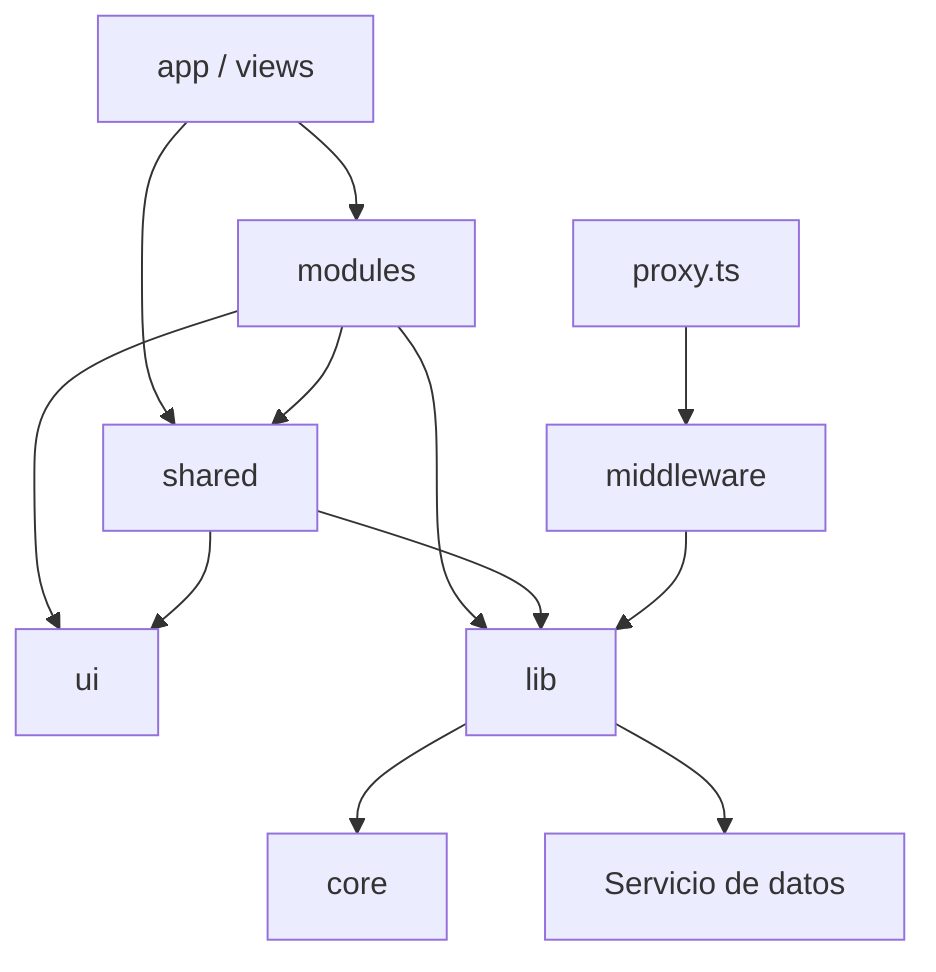

# Alivía — Arquitectura técnica del frontend

**Tecnología principal:** Next.js 16 (App Router), React 19 y TypeScript.  
**Objetivo arquitectónico:** separar navegación, presentación, composición, acceso a datos y adaptación de servicios, evitando dependencias circulares.

## Límite de la aplicación

Next.js se encarga de renderizado, layouts, navegación, estado web y tratamiento técnico de la sesión. Las operaciones de dominio y la persistencia se sitúan detrás de un contrato de servicio. Durante el simulacro ese contrato puede conectarse a un servicio de demostración con SQLite; en la integración definitiva lo atenderá una API externa.

Que una pantalla se renderice en servidor **no** convierte a Next.js en propietario del inventario, matching o base de datos. El navegador nunca accede directamente a SQLite ni recibe secretos del servicio.

## Capas y responsabilidades

| Ubicación lógica | Propietario de la responsabilidad |
|---|---|
| `src/core/` | Tipos base, constantes y contratos transversales puros. |
| `src/lib/` | Infraestructura técnica de acceso a servicios, sesión y adaptadores. |
| `src/ui/` | Componentes visuales reutilizables, independientes del dominio. |
| `src/shared/` | Piezas comunes de presentación, hooks y utilidades no específicas de un rol. |
| `src/modules/` | Funcionalidades de aplicación y coordinación local de cada área. |
| `src/modules/app/` | Shell, navegación contextual y elementos persistentes de la interfaz. |
| `src/views/` | Composición de módulos cuando una página reúne varias capacidades. |
| `src/providers/` | Contextos transversales necesarios en el árbol React. |
| `src/app/` | Segmentos, `page.tsx`, `layout.tsx` y convenciones del App Router. |
| `src/middleware/` y `src/proxy.ts` | Clasificación de rutas y decisiones preliminares de acceso web. |

Son **límites de responsabilidad**, no una exigencia de crear subcarpetas vacías. La ubicación física concreta se adapta al código que exista, sin duplicar componentes ni servicios.

## Regla de dependencias

Las capas inferiores no importan las superiores. Un módulo no utiliza archivos privados de otro módulo; las composiciones entre áreas se resuelven en la capa de composición. Las dependencias deben conservar dirección única.

## Límite servidor / navegador

Las páginas y layouts son Server Components por defecto. Los formularios, mapas, filtros interactivos y controles con eventos se aíslan en Client Components. Los módulos cliente no importan `server-only`, `next/headers`, secretos ni utilidades de acceso a cookies privadas.

El acceso a una cookie `HttpOnly` se realiza del lado del servidor. Los Route Handlers solo resuelven necesidades web concretas, como una cookie o un intermediario de transporte; no recrean los servicios del dominio.

## Tecnologías de soporte

| Área | Tecnologías empleadas o disponibles |
|---|---|
| Estilos y componentes | Tailwind CSS 4, shadcn adaptado, Base UI, Radix y Lucide. |
| Consultas y formularios | TanStack Query, React Hook Form, Zod y Axios. |
| Visualización cartográfica | Leaflet / React Leaflet; MapLibre GL disponible para casos que lo justifiquen. |
| Estado local compartido | React Context o store existente, únicamente cuando la interacción lo requiere. |
| Control de calidad | Biome, TypeScript, Vitest y Testing Library. |
| Gestor de paquetes | `pnpm` y un único lockfile correspondiente. |

La disponibilidad de una librería no obliga a utilizarla: se prefiere ampliar lo existente antes que introducir sistemas paralelos.

## Principios de evolución

La aplicación mantiene adaptadores de datos sustituibles, contratos tipados, fronteras claras entre servidor y cliente y componentes reutilizables. Una integración real puede cambiar mecanismos de comunicación sin alterar la estructura de URLs ni reescribir formularios completos.
