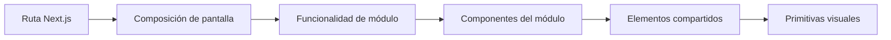

# Alivía — Módulos y pantallas del frontend

**Criterio de organización:** agrupar la interfaz por responsabilidad de usuario y por capacidades visuales reutilizables. Los módulos contienen presentación y coordinación; no constituyen implementaciones independientes de la lógica del servidor.

## Módulos por área

| Área funcional | Pantallas y componentes principales | Responsabilidad de interfaz |
|---|---|---|
| **Comuna** | Dashboard, listado y detalle de solicitudes, creación de solicitud, bandeja y detalle de recepción. | Formularios propios, cantidades con unidades, revisión antes del envío y visualización de constancias. |
| **ONG** | Dashboard, propuestas, asignaciones, despachos, inventario, ingreso y ficha de producto. | Presentar disponibilidad, estados, detalles y confirmaciones permitidas a su organización. |
| **Brigada** | Dashboard, listado y detalle de despachos. | Mostrar origen/destino, bienes autorizados, mapa de recorrido, restricciones y controles de avance habilitados. |
| **Defensa Civil** | Dashboard, mapa, entregas, brechas e informes. | Consultar información agregada y geográfica en modo de solo lectura, con filtros y descargas autorizadas. |

Cada dashboard presenta indicadores y accesos rápidos de su área; **no** funciona como sustituto de los formularios y detalles operativos.

## Funcionalidades compartidas

| Capacidad | Responsabilidad |
|---|---|
| **Shell de aplicación** | Sidebar, identidad de la entidad, encabezado de contenido, navegación activa y cierre de sesión. |
| **Presentación de estados** | Carga, lista vacía, información no disponible, errores y mensajes de resultado. |
| **Formularios** | Campos, unidades visibles, errores contextualizados, confirmaciones y bloqueo de doble envío. |
| **Datos de consulta** | Componentes y hooks para leer, actualizar y representar respuestas del servicio. |
| **Cartografía** | Contenedor de mapa, capas, marcadores, leyendas, selección y visualización de líneas viales. |
| **Documentos** | Botones de descarga, identificación de formato, errores y estado del archivo solicitado. |

Un componente compartido no debe conocer decisiones privadas de un rol. Por ejemplo, una tabla genérica dibuja filas; el módulo de ONG define sus columnas, acciones y filtros.

## Composición de páginas

Las pantallas complejas pueden combinar varias funcionalidades desde una vista de composición. Las rutas `page.tsx` permanecen pequeñas: reciben parámetros, comprueban el contexto necesario y componen la pantalla apropiada. No contienen tablas completas, formularios extensos ni lógica repetida de consulta.

## Propiedad y reutilización

- Un campo usado solo en el formulario de solicitud pertenece a esa funcionalidad, no a `ui/`.
- Una tarjeta de estado genérica pertenece al sistema visual; el significado del estado pertenece al módulo consumidor.
- Los mapas utilizan componentes cartográficos comunes y reciben capas o selecciones acotadas a cada área.
- El menú por rol se construye a partir de una configuración contextual: **un shell reutilizado**, no cuatro sidebars sin relación.
- La coordinación de información de varias áreas se realiza sin importar implementaciones internas de otros módulos.

## Límites de responsabilidad

Los módulos no crean cuentas, administran transportistas, alteran datos de otros roles ni calculan decisiones autoritativas por su cuenta. Una operación mostrada en la interfaz siempre debe corresponder a un contrato de servicio y presentar su resultado confirmado o un error recuperable.
