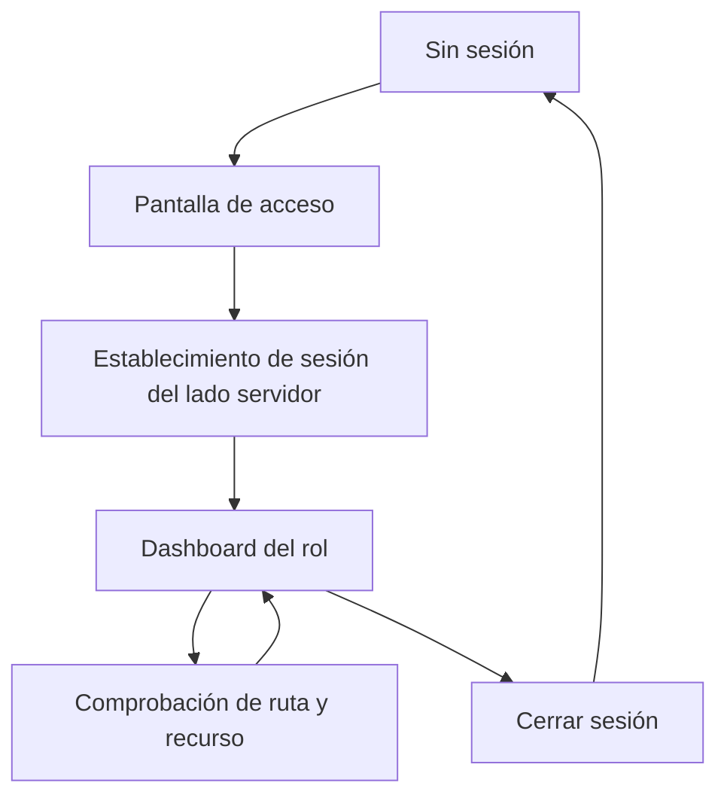

# Alivía — Sesiones y acceso por rol

**Situación del MVP:** el login de demostración sin API real **ya está integrado** en la aplicación y utiliza una cookie de sesión `HttpOnly` establecida desde el servidor web. Su mecanismo es temporal y sustituible cuando esté disponible la API de identidad definitiva.

## Modelo de acceso

La navegación se adapta a cuatro roles: Comuna (`COM`), ONG (`ONG`), Brigada (`BRI`) y Defensa Civil (`DC`). Las cuentas operativas de los tres primeros se relacionan con una entidad asignada. El rol no se elige por un parámetro en la URL ni por un valor editable desde el navegador.

| Rol | Datos que presenta el frontend | Limitación de interfaz |
|---|---|---|
| `COM` | Solicitudes y recepciones vinculadas a su comuna. | No puede administrar inventarios de ONG. |
| `ONG` | Propuestas, inventario, asignaciones y despachos propios. | No ve propuestas privadas de otras ONG. |
| `BRI` | Despachos asignados a su brigada. | No autoriza aportes de ONG ni confirma recepción comunitaria. |
| `DC` | Información territorial agregada, mapas e informes autorizados. | Toda operación es de lectura; no recibe inventario privado ni acciones de modificación. |

## Ciclo de sesión web

La cookie `HttpOnly` no puede ser leída directamente por JavaScript del navegador. El servidor web es responsable de establecerla y retirarla desde los puntos autorizados. Las decisiones preliminares de navegación pueden realizarse en `proxy.ts` y sus políticas auxiliares; una autorización de datos o una escritura requiere verificación adicional en el servicio responsable.

## Conducta frente a accesos no permitidos

- **Sin sesión:** redirigir a `/login` sin mostrar contenido privado.
- **Ya autenticado en `/login`:** ir al dashboard de su rol.
- **Prefijo de otro rol:** no renderizar contenido ajeno y conducir al inicio permitido.
- **Identificador ajeno o inexistente:** mostrar una respuesta segura sin revelar si otro usuario posee el recurso.
- **Sesión caducada:** limpiar vistas derivadas y solicitar nuevo acceso.
- **Operación denegada:** conservar el formulario cuando sea seguro y explicar el error sin filtrar detalles privados.

Los botones ocultos o deshabilitados son ayudas de experiencia, **no** una autorización de seguridad. La verificación definitiva corresponde al servicio que entrega o modifica datos.

## Sustitución del login de demostración

La sesión expone al resto de la interfaz una identidad mínima: identificador de usuario, rol, entidad asociada y estado de autenticación. Los consumidores utilizan ese contrato sin conocer si la identidad procede del mecanismo temporal o de la API definitiva.

Al integrar la API real se reemplaza el adaptador de autenticación y se ajustan las validaciones del servidor; se conservan prefijos, layouts, menús y criterios de presentación. El mecanismo demo no se describe como autenticación de producción ni se utiliza para justificar protección real sobre datos sensibles.

## Protección de información

No se guardan tokens privados en `localStorage`, se evita introducir credenciales en URLs o logs y se aísla la caché de datos privados al cambiar de usuario o cerrar sesión. Los datos de ejemplo y las cuentas ficticias de la demo se identifican como tales.
