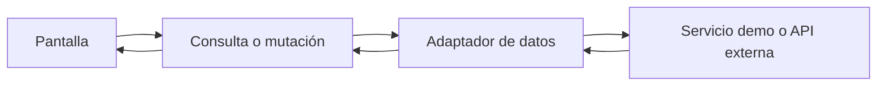

# Alivía — Datos simulados, integración y estado de interfaz

**Principio:** para los componentes, la procedencia de la información es un contrato de consulta; el frontend no depende de tablas de una base de datos ni incorpora un segundo motor de negocio.

## Origen de los datos de la demostración

El escenario utiliza entidades, necesidades, inventarios, despachos y resultados **ficticios situados en Piura**. La simulación persistente puede estar respaldada por archivos SQLite administrados por un servicio separado. Next.js se comunica con ese servicio mediante adaptadores; no ejecuta consultas SQL desde componentes ni abre archivos SQLite en el navegador.

Las capas de presentación no deben saber si el adaptador obtiene una respuesta de SQLite a través del servicio demo o de la futura API externa. La conmutación de origen conserva los modelos consumidos por las pantallas y modifica solamente el punto de integración que corresponda.

## Qué datos consume cada área

| Área | Datos necesarios para representar sus pantallas |
|---|---|
| Comuna | Identidad de comuna, catálogo de productos, solicitudes propias, cantidades, despachos destinados y recepciones. |
| ONG | Identidad de ONG, lotes/stock propios, propuestas, asignaciones y despachos de origen. |
| Brigada | Despachos asignados, estado del retiro y llegada, referencias de origen/destino y recorridos disponibles. |
| Defensa Civil | Resultados territoriales agregados, recepciones conformes, brechas, referencias cartográficas e informes publicados. |

Los identificadores se mantienen estables dentro de la demostración. Las fechas de operación se presentan en horario de Perú (`America/Lima`) y las cantidades incluyen siempre su unidad; no se suman magnitudes incompatibles.

## Estado en React

| Tipo de estado | Dónde se mantiene | Ejemplos de pantalla |
|---|---|---|
| Efímero local | `useState` o `useReducer` | Modal de confirmación, pestaña activa no compartible. |
| Formulario | React Hook Form y validación Zod cuando aplica | Nueva solicitud, ingreso a inventario, recepción. |
| Remoto | Consulta de servidor o TanStack Query | Listas, detalles, indicadores y estados de despacho. |
| Navegable | Segmentos y parámetros de URL | Recurso abierto, zona seleccionada, filtros compartibles. |
| Compartido de UI | Context o store ya adoptado | Estado del menú o selección sincronizada entre paneles. |
| Sesión | Adaptador web y cookie protegida | Rol y entidad vigentes. |

No se replica sistemáticamente la respuesta del servicio en Zustand, Valtio u otro store si ya está representada en TanStack Query. La caché no constituye una base de datos ni se considera fuente autoritativa para las cantidades.

## Consulta y actualización

Al concluir una escritura confirmada, las consultas afectadas se invalidan o actualizan de forma delimitada. Las escrituras sensibles no muestran éxito antes de conocer la respuesta, y un reintento no debe duplicar acciones. Los errores se traducen a estados diferenciados: validación, acceso, recurso ausente, conflicto y error de conexión.

## Contratos de vista

Los componentes consumen datos tipados que expresan identificador, estado, fecha, unidades y cantidades relevantes para su tarea. La adaptación de campos técnicos pertenece al servicio del módulo, no al componente genérico. Las operaciones remotas proporcionan estados de carga, éxito, ausencia y fallo recuperable.

## Separación entre realidad y simulación

Los datos de operación deben mostrar una marca de **Simulación**. Los catálogos territoriales o geometrías que tengan una fuente histórica identificable conservan su procedencia; no se presenta una localización estimada como exacta. Reiniciar la interfaz no debe confundirse con reiniciar el escenario persistido, y la presencia de SQLite no significa soporte offline para el usuario.
