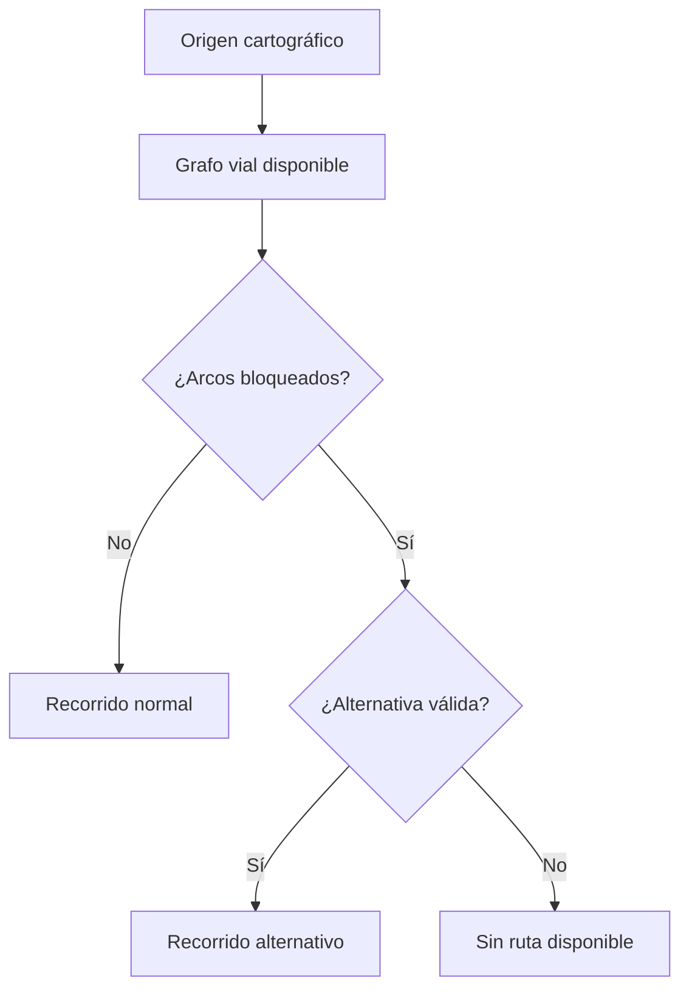

# Alivía — Mapas interactivos y recorridos viales

**Ámbito:** representación geográfica en las pantallas del frontend, limitada a la región Piura. La cartografía sirve para seleccionar, comparar y comprender referencias y escenarios; no certifica condiciones vigentes de circulación.

## Experiencia cartográfica

Los mapas permiten desplazamiento, zoom, selección de marcadores, consulta de información asociada y activación/desactivación de capas cuando están disponibles. Se utiliza Leaflet con React Leaflet para las necesidades interactivas del MVP; MapLibre GL permanece como tecnología disponible si un caso concreto requiere su motor de renderizado.

Un mapa no se reduce a una imagen: las selecciones actualizan la ficha de destino, las leyendas explican las capas y los recorridos cambian en función del escenario visualizado.

## Capas y significado

| Elemento | Representación | Límite de interpretación |
|---|---|---|
| Mapa base | Calles y geografía de referencia, con atribución. | No determina transitabilidad actual. |
| Localidades | Marcadores seleccionables con nombre y fuente. | Una ubicación sin coordenadas no recibe un pin inventado. |
| Acopios de escenario | Puntos de origen asociados a organizaciones ficticias. | Su uso operativo actual no se considera acreditado. |
| Áreas administrativas | Contornos de contexto cuando existe geometría válida. | No equivalen a perímetros de albergue ni de desastre. |
| Información histórica | Capas fechadas, por ejemplo huellas de inundación histórica. | No indican por sí mismas riesgo actual. |
| Bloqueos simulados | Segmentos destacados y etiquetados como simulación. | No se consideran reportes de tráfico reales. |
| Recorridos | Polilíneas sobre geometría vial con origen y destino. | No constituyen seguimiento GPS ejecutado. |

Los colores y símbolos se acompañan de etiquetas textuales; un marcador rojo no sustituye la descripción de su estado.

## Grafo vial y selección automática

La representación de recorridos distingue **nodos**, **arcos dirigidos** y **tramos bloqueados**. El selector consulta los recorridos viales disponibles para el escenario, excluye arcos con bloqueo conocido y prefiere una alternativa precargada viable cuando el trayecto habitual queda afectado. Si no hay recorrido verificable para la simulación, se muestra **Ruta no disponible**.

La selección es automática dentro de los recorridos y datos disponibles. No representa una optimización logística global ni consulta tráfico en tiempo real. Un segmento desconocido no se presenta como seguro y no se construyen conectores rectos para ocultar discontinuidades.

## Interacciones por espacio de usuario

- **ONG:** mapa contextual de necesidades relacionadas, referencias de origen y destino y recorrido de consulta cuando existen datos.
- **Brigada:** mapa de despachos propios, selector de envío, comparación de ruta normal, tramo bloqueado y alternativa, con disponibilidad explícita.
- **Defensa Civil:** mapa territorial de consulta con filtros, capas y referencias de atención agregadas; no muestra lotes ni inventario privado.
- **Comuna:** mantiene sus pantallas enfocadas en solicitudes y recepciones, sin exigir un mapa para completar formularios.

## Tracking simulado

La interfaz representa estados registrados del despacho y puede asociarlos a un recorrido visual. **No calcula posición en vivo, velocidad ni hora real de llegada**. Una animación o resaltado de tramos, si se utiliza, constituye una reproducción didáctica del escenario, no una telemetría recibida del vehículo.

## Datos de localización y contingencias

Los GeoJSON emplean coordenadas `[longitud, latitud]`; las APIs de Leaflet suelen recibir `[latitud, longitud]`. Las conversiones se realizan de forma explícita. Las geometrías y referencias se restringen a Piura y mantienen la precisión y fuente disponibles. Ante caída del proveedor de teselas, la interfaz conserva la información textual y permite reintentar; no borra datos ni inventa una alternativa geográfica.
